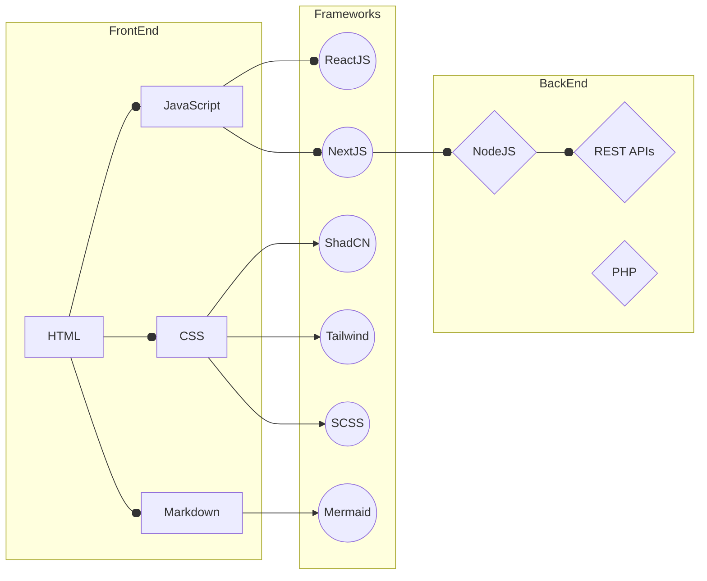

<!-- RAINBOW LINE TOP -->

  

<h1 align="center">
  Hi, I'm Jesús Enrique Fernández Prieto
  
</h1>

  

## 🚀 About me

- 3+ years of experience in web development.
- Passionate about technology, continuous learning, and creating quality digital products.
- Available to work and collaborate on innovative projects.

---

## 🛠️ Skills & Technologies

Here's a sample of the tools and languages I use to bring web projects to life:

<h3 align="center">FRONTEND</h3>

  

<h3 align="center">BACKEND</h3>

  

<h3 align="center">TOOLS</h3>

  

  
  
  
  

---

## 🌐 Languages

- Spanish (native)
- English (B1+)

---

## 📫 Contact

  
  
  

---

## 📊 GitHub Stats

  
  

  

  

---

<h2 align="center">
  Thank you for visiting my GitHub page!
  
</h2>

If you'd like to collaborate or have a proposal, please don't hesitate to contact me.

---

Jesús Enrique Fernández Prieto © 2025

